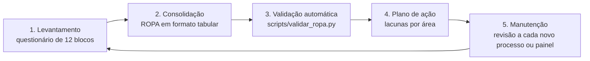

# 🔐 ROPA e Inventário de Dados Pessoais

Kit prático para construir o **Registro das Operações de Tratamento de Dados Pessoais (ROPA)** de uma organização, com foco em **processo, infraestrutura e segurança da informação**.

> ⚠️ **Dados fictícios.** A organização "Instituto Horizonte" e todos os registros deste repositório são inventados para demonstração. A metodologia é a que aplico em projetos reais.

## 🎯 Problema de negócio

Nenhuma organização consegue proteger dados que não sabe que tem. Antes de qualquer controle técnico, é preciso responder, para cada atividade:

- Quais dados pessoais são tratados, e de quem?
- Para que servem?
- Onde ficam, quem acessa e com quem são compartilhados?
- Por quanto tempo são guardados e como são descartados?

O ROPA é o inventário que responde a essas perguntas. Este repositório traz o método, os modelos e um validador automático.

## 🧭 Método em 5 etapas



1. **Levantamento.** Cada área responde ao [questionário de 12 blocos](templates/questionario_inventario_12_blocos.md), com apoio do guia de preenchimento.
2. **Consolidação.** As respostas viram linhas do [modelo de ROPA](templates/ropa_template.csv): uma linha por operação de tratamento.
3. **Validação automática.** O script aponta campos obrigatórios vazios, dados sensíveis sem medida de segurança, compartilhamentos sem operador identificado e prazos de guarda indefinidos.
4. **Plano de ação.** As lacunas são devolvidas às áreas em um relatório por responsável.
5. **Manutenção.** Todo novo processo, sistema ou painel de BI passa pelo mesmo registro antes de entrar em produção.

## 📁 Estrutura

```text
├── templates/
│   ├── ropa_template.csv                      # modelo em branco do ROPA
│   └── questionario_inventario_12_blocos.md   # roteiro de levantamento
├── dados_exemplo/
│   └── ropa_exemplo.csv                       # ROPA fictício com 14 operações
├── docs/
│   ├── fluxo_de_dados.md                      # mapa de fluxo de dados (Mermaid)
│   └── tabela_guarda_descarte.md              # prazos de guarda e forma de descarte
└── scripts/
    └── validar_ropa.py                        # validador de completude e risco
```

## ▶️ Como usar

Requer apenas Python 3.9+ (biblioteca padrão).

```bash
python scripts/validar_ropa.py dados_exemplo/ropa_exemplo.csv
```

O script imprime um resumo e grava `relatorio_validacao.md` com os apontamentos por operação e por área. O código de saída é `1` quando há apontamento crítico, o que permite usá-lo em uma esteira de CI.

## 📊 O que o validador verifica

| Regra | Severidade |
|---|---|
| Campo obrigatório vazio | Crítico |
| Dado sensível ou de criança/adolescente sem medida de segurança descrita | Crítico |
| Compartilhamento externo sem operador ou destinatário identificado | Crítico |
| Prazo de guarda indefinido ("indeterminado", "a definir") | Atenção |
| Forma de descarte não informada | Atenção |
| Transferência internacional sem país informado | Atenção |
| Hipótese de tratamento fora da lista padronizada | Atenção |

## 🛠️ Tecnologias e metodologias

Python · CSV · Mermaid · inventário de dados · mapeamento de fluxo de dados · política de guarda e descarte · privacy by design

## 👤 Autor

**Newton Giovanni** · Economista e Analista de Dados Estratégicos · [LinkedIn](https://www.linkedin.com/in/newton-giovanni/) · [Portfólio](https://github.com/newgiovanni0833)
