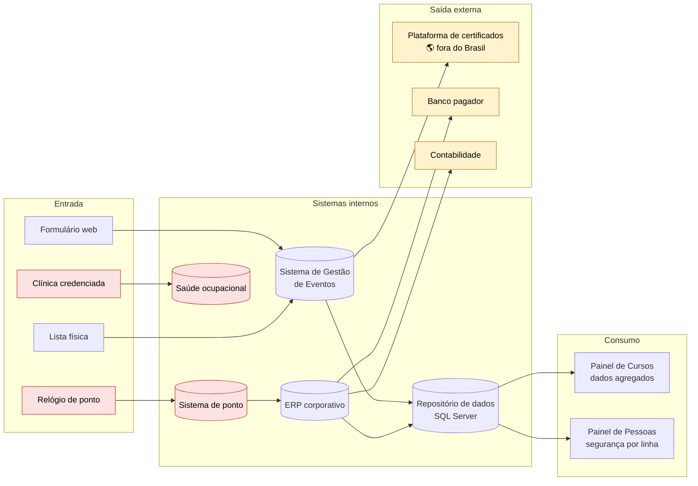

# Mapa de fluxo de dados pessoais (exemplo fictício)

O mapa mostra por onde o dado pessoal entra, onde fica armazenado, quem o consome e por onde sai da organização. Ele é desenhado a partir dos blocos 7, 9, 10 e 11 do questionário.

**Legenda:** vermelho indica fluxo com dado sensível (biometria e saúde); amarelo indica saída para terceiros.

## Pontos de controle identificados

| Ponto | Risco | Controle recomendado |
|---|---|---|
| Sistema de ponto → ERP | Biometria trafegando entre sistemas | Integrar apenas o identificador e a marcação; o template biométrico não sai do sistema de origem |
| Saúde ocupacional | Dado de saúde acessível fora da equipe técnica | Base isolada do repositório analítico; BI recebe somente indicadores agregados |
| Repositório → Painel de Pessoas | Exposição de dados individuais a gestores | Segurança em nível de linha e termo de confidencialidade por usuário |
| Sistema de eventos → Plataforma de certificados | Transferência internacional | Contrato com cláusulas de proteção de dados e envio do mínimo necessário (nome, curso, data) |
| Lista física | Perda ou acesso indevido | Digitalização, guarda em armário com chave e fragmentação ao fim do prazo |
